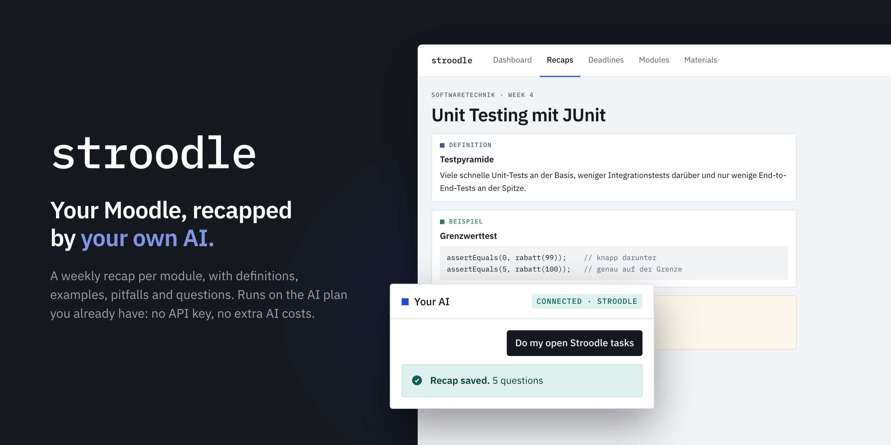

# Stroodle

**Swamped with new PDFs every week? Stroodle summarizes them for you.** - [stroodle.ch](https://stroodle.ch)

  

<b> Watch Stroodle in 22 seconds</b>

 

https://github.com/user-attachments/assets/d4741eef-d464-45dc-924a-77e97d8e77b6

Every week Moodle gives you another pile of slides, exercise sheets and scripts. Stroodle collects them per module
and week, and your own AI assistant turns them into one recap per module, with definitions, examples, things to
remember, pitfalls, to-dos and questions to check yourself.

## How it works

1. **Connect Moodle.** Stroodle uses the same kind of key the Moodle mobile app uses. It's stored encrypted and is
   never shown to your AI.
2. **Choose your modules** and how long each recap should be, from calendar only to long.
3. **Connect your AI.** Add Stroodle to your assistant as a connector (Claude first, other MCP clients later).
4. **Say "Do my open Stroodle tasks".** Your AI reads the new materials, writes the recaps and saves them back to
   Stroodle, where you read them and answer the questions.

## What it costs you in AI

Nothing extra. The AI doesn't run on Stroodle's servers: the recaps are written by the AI plan you already have.
No API key, no extra AI costs.

## Feedback

This repository is the public home of Stroodle. The app's source code is not public.

- **Found a bug?** [Report it](https://github.com/baltermia/stroodle-ch/issues/new?template=bug_report.yml).
- **Have an idea or a feature request?** [Suggest it](https://github.com/baltermia/stroodle-ch/issues/new?template=feature_request.yml).
  If someone already asked for it, add a 👍 to their issue instead; that shows what people want most.

Please never post anything confidential, as issues are public. For further support, contact us at [support@stroodle.ch](mailto:support@stroodle.ch).
